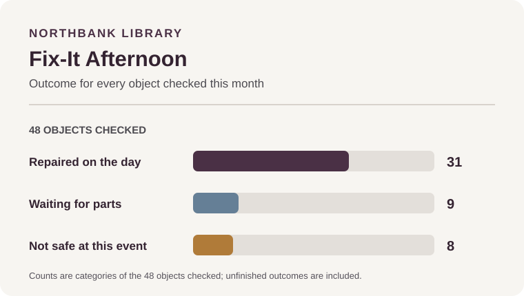

# IB MYP Year 4 / Grade 9 Diagnostic — Read & View draft v0.1

**Status:** Authoring draft for human academic review. Not calibrated, approved, implemented in the learner app or released.
**Target:** Founder-confirmed Grade 9 — IB MYP Year 4, Language and Literature.
**Item map:** Founder-approved v0.1, Read & View 25-minute task; ten observations RV01–RV09 (RV07a and RV07b are separate).
**Sitting:** Sitting 1, Read & View, 25 minutes.
**Content version:** 0.1-draft, created 10 November 2026.
**Answer-key boundary:** This public learner-content draft contains no correct-answer key, distractor rationales, private scoring logic or teacher notes. The companion teacher/editor pack is held separately from the public repository.

## Administration notes for review

Present both stimuli before the questions. The literary and non-literary stimuli are original drafts and do not require specialist background knowledge. The SVG chart is an original project-authored visual; the plain-text data below is its accessible equivalent. The total task target is 25 minutes. Do not block a typed response when it exceeds its ideal word-count target.

This is a draft item set, not an official IB task or eAssessment replica. The proposed word ranges/ideal counts are task guidance and must be checked in timing and accessibility review.

## Stimulus A — Literary text

**Excerpt ID:** `MYP4-RV-EX-001`
**Working title:** The Repair Table
**Body length:** 225 words (title excluded).
**Response task links:** RV01, RV02, RV03, RV07a, RV07b, RV08.

When the hall doors opened, the folding table was already crowded with objects that had stopped working: a lamp with a stubborn switch, a clock that lost five minutes every hour, and a blue bicycle with a loose bell. Nia had come to help, but she kept looking at the pile of things waiting on the floor.

“We can repair all of them,” she said.

Mr Sen, who ran the weekly repair afternoon, did not answer at once. He checked the lamp’s label, then set it aside. “Not safely today,” he said. “We need the right part and someone qualified to fit it.”

Nia frowned. The clock, however, was simple: its loose back had let the battery slide out of place. She held the torch while Mr Sen fitted the cover. The hands began moving again, first with a small jump, then steadily.

At the far end of the table, a child rang the bicycle bell. Its bright note crossed the hall and made two waiting people laugh. Nia looked back at the lamp. It was still broken, but it no longer seemed like proof that the afternoon had failed.

On a card, she wrote: “Fixed today: one clock, one bell. Next time: the lamp.” Then she placed the card beside the waiting pile, where everyone could see what had happened—and what had not.

## Stimulus B — Non-literary multimodal text

**Excerpt ID:** `MYP4-RV-EX-002`
**Working title:** Fix-It Afternoon
**Rights-count body length:** 117 words (tagline and data labels included; institution name, main title and section heading excluded). All visible text, including those headings, is 124 words.
**Response task links:** RV04, RV05, RV06, RV07a, RV07b, RV09.

### Poster copy

**NORTHBANK LIBRARY**
# FIX-IT AFTERNOON
*Small repairs. Shared skills.*

Bring one small household object to the community hall. You do not need to know how to repair it: volunteers will explain what can be checked safely.

**THIS MONTH’S RECORD**

- 48 objects checked
- 31 repaired on the day
- 9 waiting for parts
- 8 not safe to repair at this event

The chart shows the outcome for every object checked. “Waiting for parts” means the team has not yet completed the repair. “Not safe to repair” means the object needs a different service or should not be handled at this event.

You can watch, ask questions or help with a simple task chosen by a volunteer. The team will not promise that every object can be fixed.

### Original visual asset

**Accessible text equivalent:** Of 48 objects checked, 31 were repaired that day, 9 were awaiting parts and 8 were not safe to repair at this event. The three outcomes account for all 48 objects.

## Learner questions — draft wording

### RV01 — Main idea and explicit detail

**RV01a.** Which statement best expresses the central idea of Stimulus A?

A. The group proves that careful planning makes every object repairable.
B. Nia learns that a useful repair afternoon can include honest limits and small successes.
C. Mr Sen discourages visitors from asking questions about repairs.
D. The bicycle bell is the main reason visitors attend the event.

**RV01b.** Select **two** details from Stimulus A that show that some work could not be completed that afternoon.

A. Mr Sen sets the lamp aside because the right part and a qualified person are needed.
B. The clock begins moving after Mr Sen fits its cover.
C. Nia writes “Next time: the lamp” on the card.
D. A child rings the bicycle bell.

### RV02 — Inference and interpretation

Why does Nia place the card beside the waiting pile at the end of Stimulus A? Explain what this action suggests about how her view of the afternoon has changed.

**Response guidance:** 35–45 words. **Ideal target:** 40 words.

### RV03 — Creator’s choice

Explain how the phrase **“Its bright note crossed the hall”** shapes the atmosphere at that moment and contributes to the reader’s understanding of Nia’s response.

**Response guidance:** 35–50 words. **Ideal target:** 45 words.

### RV04 — Context, audience and purpose

Who is the most likely audience for Stimulus B, and what is the poster mainly designed to do?

A. Local residents who may bring an object; invite participation while explaining the event’s results and safety limits.
B. Professional technicians; provide a detailed training manual for replacing parts.
C. Children attending a music performance; advertise a concert.
D. Collectors; prove that every household object can be repaired.

### RV05 — Visual and verbal interpretation

Which statement accurately interprets the outcome graphic in Stimulus B?

A. 31 objects were repaired that day; 17 were not completed that day because 9 were waiting for parts and 8 were not safe to repair at this event.
B. 31 objects were waiting for parts; 17 were repaired that day.
C. All 48 objects were repaired that day.
D. Only 8 objects were checked.

### RV06 — Analysing a represented claim

The poster says **“Small repairs. Shared skills.”** Analyse how the poster's wording and outcome figures together present the event's achievements and its limits. Support your interpretation with at least one figure and explain how a particular wording choice shapes the reader's understanding.

**Response guidance:** 35–45 words. **Ideal target:** 40 words.

### RV07a — Compare perspectives

How do Nia in Stimulus A and the poster in Stimulus B present what counts as a successful repair afternoon? Use relevant evidence from both stimuli.

**Response guidance:** 45–60 words. **Ideal target:** 50 words.

### RV07b — Compare form, structure and creator choices

How do the story’s sequence and the poster’s visual categories guide the reader in different ways? Refer to one specific choice in each stimulus.

**Response guidance:** 45–60 words. **Ideal target:** 50 words.

### RV08 — Sequence and structural development

Number these events from **1 to 5** in the order they occur in Stimulus A.

- Nia writes a card recording what was fixed and what remains for another time.
- Nia arrives and sees objects waiting on the floor.
- Mr Sen sets the lamp aside because it cannot safely be repaired at the event.
- The clock is repaired.
- The bicycle bell rings and makes people laugh.

Then explain in one sentence how this sequence helps the reader understand the change in Nia’s view.

**Response guidance for the sentence:** 15–25 words. **Ideal target:** 20 words.

### RV09 — Evidence selection and reasoning

Which part of Stimulus B is the strongest evidence for the claim that the poster reports both completed and unfinished outcomes?

A. “Small repairs. Shared skills.”
B. “31 repaired on the day; 9 waiting for parts; 8 not safe to repair at this event.”
C. “Bring one small household object to the community hall.”
D. “You do not need to know how to repair it.”

Explain briefly why the selected information is stronger evidence for the claim than one of the other statements.

**Response guidance:** 15–25 words. **Ideal target:** 20 words.

## Draft coverage check

| Observation | Intended evidence | Primary taxonomy |
|---|---|---|
| RV01 | Central idea plus more than one explicit detail | A1 |
| RV02 | Inference supported by a relevant detail | A2, A5 |
| RV03 | Contextual effect of a creator’s language choice | A4, A5 |
| RV04 | Audience, context and purpose | A3 |
| RV05 | Visual/verbal data interpretation | A1, A2, A4 |
| RV06 | Evaluate a claim against evidence and limits | A7, A5 |
| RV07a | Compare perspectives/ideas | A6, A5 |
| RV07b | Compare form, structure and effect | A6, A4 |
| RV08 | Sequence and structural development | A1, A4 |
| RV09 | Select strongest evidence and justify relevance | A5 |

## Review status and open gates

- Originality/provenance phrase check: limited exact-phrase search recorded in the excerpt register; no exact match surfaced in the searches run. This is not a comprehensive plagiarism screen or legal opinion.
- Human academic review: **pending**.
- Independent Year 4 demand/suitability calibration: **pending**; no authorised school materials were supplied, so do not present this as official IB mapping.
- Answer-key and distractor-rationale validation: **pending human review**; see the separate teacher/editor pack.
- Accessibility review: **pending** (keyboard, screen-reader reading order, chart alternative text and contrast).
- Timing/pilot validation: **pending**.
- Final rubric anchors, aggregation, priority thresholds and cut scores: **not set**.
- Learner release/app integration: **not approved**.
